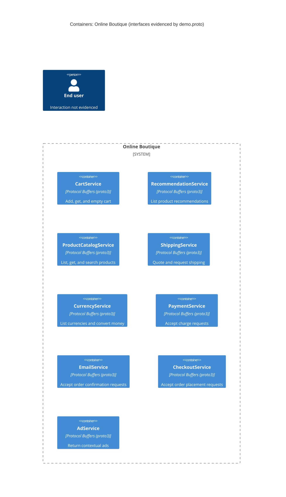

# Agent

Codex (GPT-6)

# Files read

- `prompts/1-recover-architecture.md`
- `system/online-boutique/protos/demo.proto`

# Containers table

ตารางนี้แสดง service interface ที่ประกาศใน `demo.proto` ในฐานะ container เชิงตรรกะเท่านั้น การมี container ที่รันจริงและภาษาที่ใช้พัฒนายัง **Not evidenced in the provided files**. ทุก service มีสัญญา API แบบ Protocol Buffers (`syntax = "proto3"`); ค่า `go_package` ไม่ยืนยันภาษาของ implementation.

| ชื่อ | เทคโนโลยี/ภาษา | หน้าที่ตาม RPC ที่ประกาศ | หลักฐาน |
| --- | --- | --- | --- |
| `CartService` | Protocol Buffers (`proto3`); ภาษาไม่ปรากฏ | เพิ่มสินค้า ดูตะกร้า และล้างตะกร้า | `system/online-boutique/protos/demo.proto` (`service CartService`; `AddItem`, `GetCart`, `EmptyCart`) |
| `RecommendationService` | Protocol Buffers (`proto3`); ภาษาไม่ปรากฏ | ให้รายการสินค้าแนะนำ | `system/online-boutique/protos/demo.proto` (`service RecommendationService`; `ListRecommendations`) |
| `ProductCatalogService` | Protocol Buffers (`proto3`); ภาษาไม่ปรากฏ | แสดงรายการ ค้นหา และดึงข้อมูลสินค้า | `system/online-boutique/protos/demo.proto` (`service ProductCatalogService`; `ListProducts`, `GetProduct`, `SearchProducts`) |
| `ShippingService` | Protocol Buffers (`proto3`); ภาษาไม่ปรากฏ | คำนวณค่าจัดส่งและรับคำขอจัดส่ง | `system/online-boutique/protos/demo.proto` (`service ShippingService`; `GetQuote`, `ShipOrder`) |
| `CurrencyService` | Protocol Buffers (`proto3`); ภาษาไม่ปรากฏ | แสดงสกุลเงินที่รองรับและแปลงจำนวนเงิน | `system/online-boutique/protos/demo.proto` (`service CurrencyService`; `GetSupportedCurrencies`, `Convert`) |
| `PaymentService` | Protocol Buffers (`proto3`); ภาษาไม่ปรากฏ | รับคำขอเรียกเก็บเงิน | `system/online-boutique/protos/demo.proto` (`service PaymentService`; `Charge`) |
| `EmailService` | Protocol Buffers (`proto3`); ภาษาไม่ปรากฏ | รับคำขอส่งอีเมลยืนยันคำสั่งซื้อ | `system/online-boutique/protos/demo.proto` (`service EmailService`; `SendOrderConfirmation`) |
| `CheckoutService` | Protocol Buffers (`proto3`); ภาษาไม่ปรากฏ | รับคำขอสร้างคำสั่งซื้อ | `system/online-boutique/protos/demo.proto` (`service CheckoutService`; `PlaceOrder`) |
| `AdService` | Protocol Buffers (`proto3`); ภาษาไม่ปรากฏ | ให้รายการโฆษณาตามบริบทที่ส่งมา | `system/online-boutique/protos/demo.proto` (`service AdService`; `GetAds`) |

# Dependencies table

| ผู้เรียก → ผู้รับ | โปรโตคอล | หลักฐาน |
| --- | --- | --- |

ไม่มีความสัมพันธ์ระหว่าง service ขณะทำงานที่ยืนยันได้จาก `system/online-boutique/protos/demo.proto`: การประกาศ `rpc` ระบุ endpoint แต่ไม่ระบุผู้เรียก การใช้ message type ร่วมกันก็ไม่ยืนยันการเรียกข้าม service.

# Mermaid diagram

# Gaps

- ผู้เรียกของแต่ละ RPC รวมถึงความสัมพันธ์ของผู้ใช้กับระบบ: **Not evidenced in the provided files**. ต้องอ่าน source code ของผู้เรียกหรือไฟล์กำหนดค่า service address เช่น `system/online-boutique/kubernetes-manifests/frontend.yaml` เพื่อยืนยัน.
- การ deploy เป็น container จริง ภาษาที่ใช้ และ dependency ต่อ data store หรือระบบภายนอก: **Not evidenced in the provided files**. ต้องอ่าน deployment manifests และ source code ของแต่ละ service ใน `system/online-boutique/` เพื่อยืนยัน.
- โปรโตคอลที่ใช้จริงระหว่าง service: **Not evidenced in the provided files**. `rpc` ในไฟล์สัญญาไม่ยืนยันการเชื่อมต่อขณะทำงาน; ต้องอ่าน source code ของ client และการตั้งค่าการเชื่อมต่อ.
