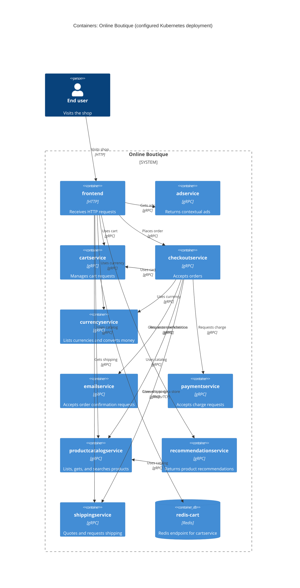

# Agent

Codex (GPT-6)

# Files read

- `prompts/1-recover-architecture.md`
- `system/online-boutique/protos/demo.proto`
- `system/online-boutique/kubernetes-manifests/adservice.yaml`
- `system/online-boutique/kubernetes-manifests/cartservice.yaml`
- `system/online-boutique/kubernetes-manifests/checkoutservice.yaml`
- `system/online-boutique/kubernetes-manifests/currencyservice.yaml`
- `system/online-boutique/kubernetes-manifests/emailservice.yaml`
- `system/online-boutique/kubernetes-manifests/frontend.yaml`
- `system/online-boutique/kubernetes-manifests/kustomization.yaml`
- `system/online-boutique/kubernetes-manifests/loadgenerator.yaml`
- `system/online-boutique/kubernetes-manifests/paymentservice.yaml`
- `system/online-boutique/kubernetes-manifests/productcatalogservice.yaml`
- `system/online-boutique/kubernetes-manifests/recommendationservice.yaml`
- `system/online-boutique/kubernetes-manifests/shippingservice.yaml`

# Containers table

ตารางนี้แสดง deployment ที่ `kustomization.yaml` เปิดใช้งาน รวม `redis-cart` ที่ประกาศใน `cartservice.yaml` ด้วย ชื่อภาษา implementation ของ image ต่าง ๆ **Not evidenced in the provided files**; `go_package` ใน `demo.proto` เป็นตัวเลือกของไฟล์สัญญา ไม่ยืนยันภาษาของทุก service.

| ชื่อ | เทคโนโลยี/ภาษา | หน้าที่ | หลักฐาน |
| --- | --- | --- | --- |
| `frontend` | HTTP บน Kubernetes; ภาษาไม่ปรากฏ | รับคำขอ HTTP ผ่านพอร์ต 80 | `system/online-boutique/kubernetes-manifests/frontend.yaml` (`Deployment/frontend`, `Service/frontend-external`, `ports.name: http`) |
| `adservice` | gRPC บน Kubernetes; ภาษาไม่ปรากฏ | ให้รายการโฆษณาตามบริบท | `system/online-boutique/kubernetes-manifests/adservice.yaml` (`Deployment/adservice`, `ports.name: grpc`); `system/online-boutique/protos/demo.proto` (`AdService.GetAds`) |
| `cartservice` | gRPC บน Kubernetes; ภาษาไม่ปรากฏ | เพิ่มสินค้า ดูตะกร้า และล้างตะกร้า | `system/online-boutique/kubernetes-manifests/cartservice.yaml` (`Deployment/cartservice`, `ports.name: grpc`); `system/online-boutique/protos/demo.proto` (`CartService.AddItem`, `GetCart`, `EmptyCart`) |
| `checkoutservice` | gRPC บน Kubernetes; ภาษาไม่ปรากฏ | รับคำขอสั่งซื้อ | `system/online-boutique/kubernetes-manifests/checkoutservice.yaml` (`Deployment/checkoutservice`, `ports.name: grpc`); `system/online-boutique/protos/demo.proto` (`CheckoutService.PlaceOrder`) |
| `currencyservice` | gRPC บน Kubernetes; ภาษาไม่ปรากฏ | แสดงสกุลเงินที่รองรับและแปลงจำนวนเงิน | `system/online-boutique/kubernetes-manifests/currencyservice.yaml` (`Deployment/currencyservice`, `ports.name: grpc`); `system/online-boutique/protos/demo.proto` (`CurrencyService.GetSupportedCurrencies`, `Convert`) |
| `emailservice` | gRPC บน Kubernetes; ภาษาไม่ปรากฏ | รับคำขอส่งอีเมลยืนยันคำสั่งซื้อ | `system/online-boutique/kubernetes-manifests/emailservice.yaml` (`Deployment/emailservice`, `ports.name: grpc`); `system/online-boutique/protos/demo.proto` (`EmailService.SendOrderConfirmation`) |
| `paymentservice` | gRPC บน Kubernetes; ภาษาไม่ปรากฏ | รับคำขอเรียกเก็บเงิน | `system/online-boutique/kubernetes-manifests/paymentservice.yaml` (`Deployment/paymentservice`, `ports.name: grpc`); `system/online-boutique/protos/demo.proto` (`PaymentService.Charge`) |
| `productcatalogservice` | gRPC บน Kubernetes; ภาษาไม่ปรากฏ | แสดงรายการ ดึงข้อมูล และค้นหาสินค้า | `system/online-boutique/kubernetes-manifests/productcatalogservice.yaml` (`Deployment/productcatalogservice`, `ports.name: grpc`); `system/online-boutique/protos/demo.proto` (`ProductCatalogService.ListProducts`, `GetProduct`, `SearchProducts`) |
| `recommendationservice` | gRPC บน Kubernetes; ภาษาไม่ปรากฏ | ให้รายการสินค้าแนะนำ | `system/online-boutique/kubernetes-manifests/recommendationservice.yaml` (`Deployment/recommendationservice`, `ports.name: grpc`); `system/online-boutique/protos/demo.proto` (`RecommendationService.ListRecommendations`) |
| `shippingservice` | gRPC บน Kubernetes; ภาษาไม่ปรากฏ | คำนวณค่าจัดส่งและรับคำขอจัดส่ง | `system/online-boutique/kubernetes-manifests/shippingservice.yaml` (`Deployment/shippingservice`, `ports.name: grpc`); `system/online-boutique/protos/demo.proto` (`ShippingService.GetQuote`, `ShipOrder`) |
| `redis-cart` | Redis (`redis:alpine`); ภาษาไม่เกี่ยวข้อง | เป็นปลายทาง Redis ที่ `cartservice` ชี้ถึง | `system/online-boutique/kubernetes-manifests/cartservice.yaml` (`Deployment/redis-cart`, `image: redis:alpine`, `REDIS_ADDR`) |

# Dependencies table

แต่ละแถวเป็นความสัมพันธ์ที่กำหนดค่าไว้ใน manifest; ชื่อพอร์ต `grpc` ของ service ปลายทางและ RPC ใน `demo.proto` สนับสนุนการระบุโปรโตคอล gRPC ส่วนการเข้าเว็บใช้ `Service/frontend-external` พอร์ต `http`.

| ผู้เรียก → ผู้รับ | โปรโตคอล | หลักฐาน |
| --- | --- | --- |
| ผู้ใช้ → `frontend` | HTTP | `system/online-boutique/kubernetes-manifests/frontend.yaml` (`Service/frontend-external`, `type: LoadBalancer`, `ports.name: http`, `port: 80`) |
| `frontend` → `productcatalogservice` | gRPC | `system/online-boutique/kubernetes-manifests/frontend.yaml` (`PRODUCT_CATALOG_SERVICE_ADDR`); `system/online-boutique/kubernetes-manifests/productcatalogservice.yaml` (`ports.name: grpc`) |
| `frontend` → `currencyservice` | gRPC | `system/online-boutique/kubernetes-manifests/frontend.yaml` (`CURRENCY_SERVICE_ADDR`); `system/online-boutique/kubernetes-manifests/currencyservice.yaml` (`ports.name: grpc`) |
| `frontend` → `cartservice` | gRPC | `system/online-boutique/kubernetes-manifests/frontend.yaml` (`CART_SERVICE_ADDR`); `system/online-boutique/kubernetes-manifests/cartservice.yaml` (`ports.name: grpc`) |
| `frontend` → `recommendationservice` | gRPC | `system/online-boutique/kubernetes-manifests/frontend.yaml` (`RECOMMENDATION_SERVICE_ADDR`); `system/online-boutique/kubernetes-manifests/recommendationservice.yaml` (`ports.name: grpc`) |
| `frontend` → `shippingservice` | gRPC | `system/online-boutique/kubernetes-manifests/frontend.yaml` (`SHIPPING_SERVICE_ADDR`); `system/online-boutique/kubernetes-manifests/shippingservice.yaml` (`ports.name: grpc`) |
| `frontend` → `checkoutservice` | gRPC | `system/online-boutique/kubernetes-manifests/frontend.yaml` (`CHECKOUT_SERVICE_ADDR`); `system/online-boutique/kubernetes-manifests/checkoutservice.yaml` (`ports.name: grpc`) |
| `frontend` → `adservice` | gRPC | `system/online-boutique/kubernetes-manifests/frontend.yaml` (`AD_SERVICE_ADDR`); `system/online-boutique/kubernetes-manifests/adservice.yaml` (`ports.name: grpc`) |
| `checkoutservice` → `productcatalogservice` | gRPC | `system/online-boutique/kubernetes-manifests/checkoutservice.yaml` (`PRODUCT_CATALOG_SERVICE_ADDR`); `system/online-boutique/kubernetes-manifests/productcatalogservice.yaml` (`ports.name: grpc`) |
| `checkoutservice` → `shippingservice` | gRPC | `system/online-boutique/kubernetes-manifests/checkoutservice.yaml` (`SHIPPING_SERVICE_ADDR`); `system/online-boutique/kubernetes-manifests/shippingservice.yaml` (`ports.name: grpc`) |
| `checkoutservice` → `paymentservice` | gRPC | `system/online-boutique/kubernetes-manifests/checkoutservice.yaml` (`PAYMENT_SERVICE_ADDR`); `system/online-boutique/kubernetes-manifests/paymentservice.yaml` (`ports.name: grpc`) |
| `checkoutservice` → `emailservice` | gRPC | `system/online-boutique/kubernetes-manifests/checkoutservice.yaml` (`EMAIL_SERVICE_ADDR`); `system/online-boutique/kubernetes-manifests/emailservice.yaml` (`ports.name: grpc`) |
| `checkoutservice` → `currencyservice` | gRPC | `system/online-boutique/kubernetes-manifests/checkoutservice.yaml` (`CURRENCY_SERVICE_ADDR`); `system/online-boutique/kubernetes-manifests/currencyservice.yaml` (`ports.name: grpc`) |
| `checkoutservice` → `cartservice` | gRPC | `system/online-boutique/kubernetes-manifests/checkoutservice.yaml` (`CART_SERVICE_ADDR`); `system/online-boutique/kubernetes-manifests/cartservice.yaml` (`ports.name: grpc`) |
| `recommendationservice` → `productcatalogservice` | gRPC | `system/online-boutique/kubernetes-manifests/recommendationservice.yaml` (`PRODUCT_CATALOG_SERVICE_ADDR`); `system/online-boutique/kubernetes-manifests/productcatalogservice.yaml` (`ports.name: grpc`) |
| `cartservice` → `redis-cart` | Redis/TCP | `system/online-boutique/kubernetes-manifests/cartservice.yaml` (`REDIS_ADDR=redis-cart:6379`, `Service/redis-cart`, `ports.name: tcp-redis`) |

# Mermaid diagram

# Gaps

- ภาษา implementation ของ service และการเรียก RPC ใดในแต่ละความสัมพันธ์: **Not evidenced in the provided files**. ต้องอ่าน source code ของ service แต่ละตัวใน `system/online-boutique/` เพื่อยืนยัน; `go_package` ใน `demo.proto` ไม่เพียงพอ.
- `frontend.yaml` ตั้ง `SHOPPING_ASSISTANT_SERVICE_ADDR=shoppingassistantservice:80` แต่ไม่มี deployment หรือ service นี้ใน `kustomization.yaml` และตัวอย่าง `ENABLE_ASSISTANT` ถูกคอมเมนต์ไว้ จึงยังยืนยันการเรียกขณะทำงานและโปรโตคอลไม่ได้ ต้องอ่าน source code ของ `frontend` และ manifest ของ `shoppingassistantservice` เพื่อยืนยัน.
- `loadgenerator.yaml` ประกาศ deployment และ `FRONTEND_ADDR=frontend:80` แต่ `kustomization.yaml` คอมเมนต์การรวมไฟล์นี้ไว้ จึงไม่ได้แสดงในแผนภาพของ deployment หลัก ต้องอ่าน `system/online-boutique/skaffold.yaml` หรือการตั้งค่า deploy จริงเพื่อยืนยันว่าใช้หรือไม่.
- การคงอยู่ของข้อมูลตะกร้าหลัง pod สิ้นสุด: `cartservice.yaml` กำหนด `redis-cart` ให้ใช้ `emptyDir` แต่พฤติกรรมการบันทึกของ Redis **Not evidenced in the provided files**. ต้องอ่านการตั้งค่าหรือ source code ของ `redis-cart` เพื่อยืนยัน.
